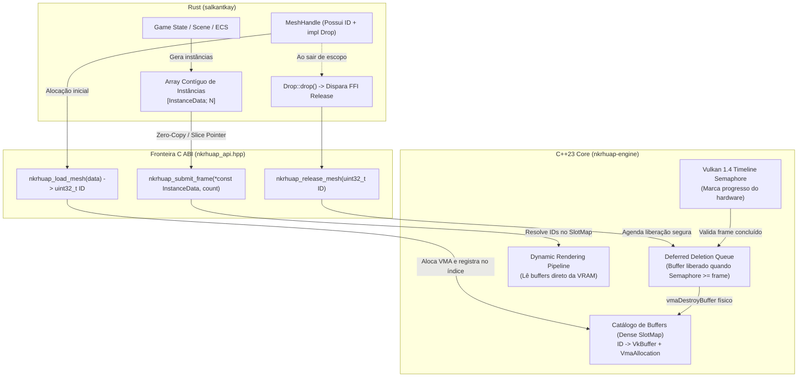

<div align="center">

  # nkrhuap engine

</div>

**Um motor gráfico e computacional de baixo nível em C++23 e Vulkan 1.4, consumido por um cliente em Rust.**

## Tese
- Layouts contíguos e amigáveis ao cache L1/L2/L3, seguindo os principios de Data-Oriented Design e ademais ideias que circulam a Computação de Alto Desempenho;
- Ausência de vtables no loop de renderização, uso de metaprogramação em C++ e tipos de tamanho estático;
- Assimetria Temporal CPU-GPU, Ownership tipada, RAII de custo zero e Deferred Deletion.

## Arquitetura
1. O Núcleo Gráfico (`nkrhuap engine`): Em C++23, focado em hardware, controle fino de memória e ausência total de código legado, usando o que há de mais moderno no Vulkan 1.4;
2. O Jogo (`salkantkay`): Em Rust, projetado para conter a lógica de gameplay, ciclo de vida e gerenciamento seguro de estado.

### Objetivo a ser atingido


## Build e Run
**Pré-requisitos:**
- Clang
- C++23
- Rust toolchain
- CMake and Ninja
- Vulkan SDK (v1.14)

```bash
cd salkantkay/
cargo run
```
